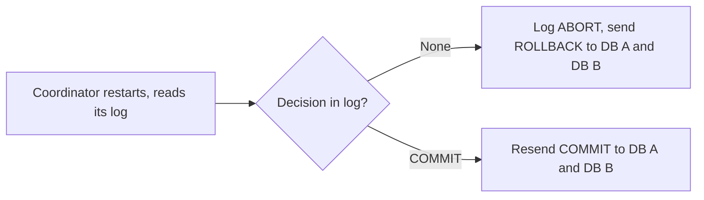

Two-phase commit (2PC) is a protocol for running distributed transactions.

Whenever we need an operation to be atomic across multiple systems, we want to treat the work done in each system as part of a single transaction: either every system commits, or none does. 2PC is a common mechanism for achieving this.

As the name suggests, 2PC works in two phases: a **prepare phase** and a **commit phase**The **coordinator** manages the participating systems.

For Example : 

Say we have two separate PostgreSQL databases and want to transfer ₹100 atomically:

- DB A (accounts): subtract ₹100 from account 1’s balance (an update).
- DB B (ledger): record the transfer (an insert).

### Phase 1: Prepare

The coordinator asks each participant whether it’s ready to commit. Each participant performs the work, saves it durably without making it visible, and replies with a vote: **yes** (ready to commit) or **no**.

```sql
-- On DB A
BEGIN;
UPDATE accounts SET balance = balance - 100 WHERE id = 1;
PREPARE TRANSACTION 'transfer-42';

-- On DB B
BEGIN;
INSERT INTO transfers (id, from_account, amount) VALUES (42, 1, 100);
PREPARE TRANSACTION 'transfer-42';
```

During the prepare phase, each participant actually runs its update or insert and checks constraints; if anything fails, such as a negative balance or a duplicate ID, it votes no. 

When it runs `PREPARE TRANSACTION`, it flushes the transaction’s changes from the WAL to disk, so the prepared transaction survives a crash.

It also holds pessimistic locks during transaction so no other transaction can modify the same rows before the final decision, since a “yes” vote is a promise that it can commit no matter what. The changes stay invisible to others because PostgreSQL uses MVCC. So readers keep seeing the old balance without waiting, while other writers are blocked. The coordinator moves on to the commit phase only if every participant votes yes.

### Phase 2 : Commit Phase 

If every participant voted yes, the coordinator tells all of them to commit:

```sql
COMMIT PREPARED 'transfer-42';   -- on DB A and DB B
```

Committing doesn’t rewrite the rows. PostgreSQL simply marks the transaction as committed, which instantly makes the new versions visible and the old ones obsolete. Locks are then released.

If any participant votes no, or fails to respond in time, the coordinator instead tells all participants to roll back:

```sql
ROLLBACK PREPARED 'transfer-42';
```

The new versions are discarded, the old ones remain current, and locks are released. Obsolete row versions are cleaned up later by VACUUM.

### Logs: what each side writes down

2PC only survives crashes because both the coordinator and every participant keep a durable log, which is flushed to disk *before* they send any message. After a crash, each node reads its own log to work out where it stopped.

- **Participant** logs `PREPARED` before voting yes, then `COMMIT` / `ABORT` when told.
- **Coordinator** logs its decision (`COMMIT` / `ABORT`) before telling anyone. Once that's on disk, the outcome is final.

![[2pc-logging.svg]]

### Scenario 1: a participant goes unavailable

DB B doesn't reply to PREPARE. The coordinator times out, logs `ABORT`, and rolls back DB A. When DB B comes back, the coordinator answers from its log.

![[2pc-participant-down.svg]]


If DB B had already voted YES before going down, the coordinator has logged `COMMIT`, so it keeps retrying `COMMIT` until DB B is back.

### Scenario 2: the coordinator crashes

Both databases vote YES, then the coordinator crashes. They're stuck in `PREPARED`, holding locks, until it comes back.

![[2pc-coordinator-crash.svg]]


When the coordinator restarts, its log decides what happens:



### Drawback: the blocking problem

If the coordinator crashes after participants have voted yes but before sending its decision, those participants can neither commit nor roll back on their own. They keep holding their locks, even across database restarts, until the coordinator recovers or an admin resolves the transaction manually. 


For more details : 
- https://cs186berkeley.net/sp21/resources/static/notes/n15-DistXact.pdf 
- https://pages.cs.wisc.edu/~yxy/cs764-f20/slides/L11.pdf


