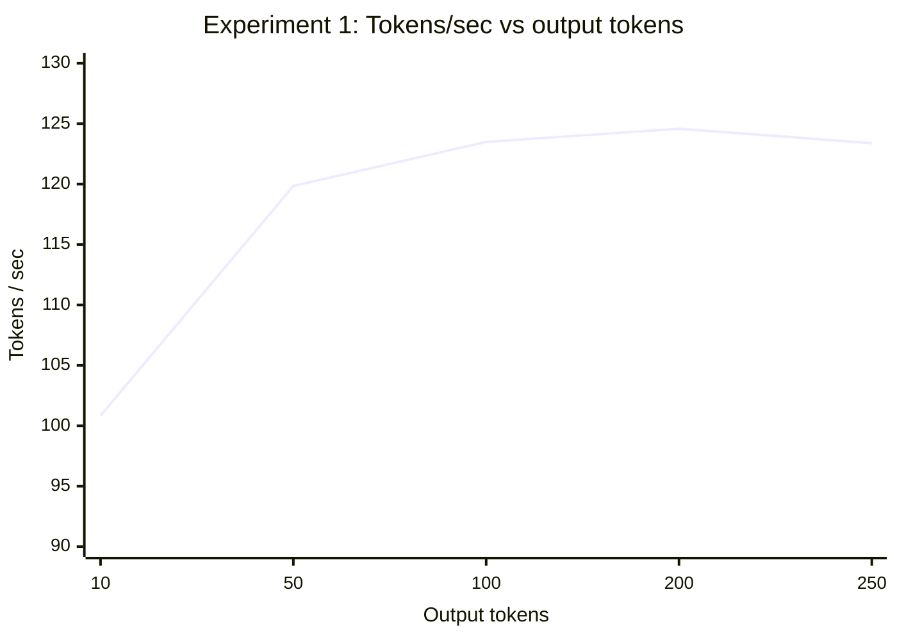
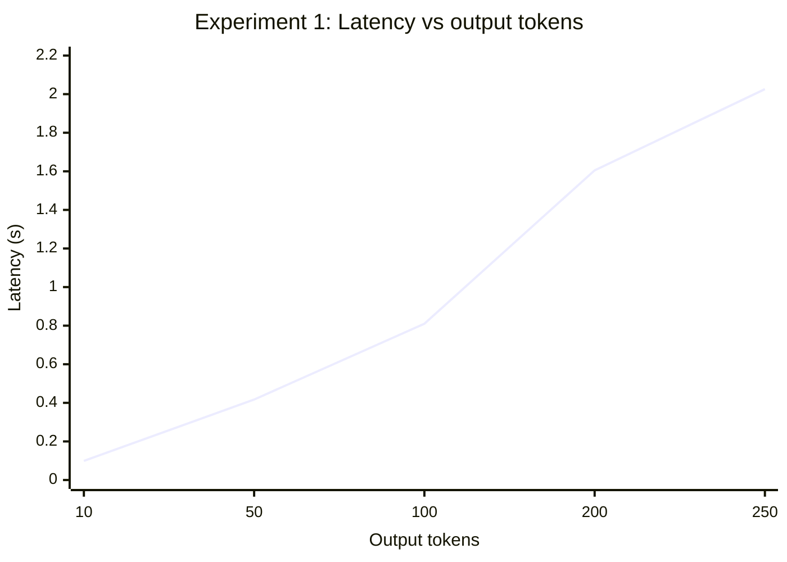
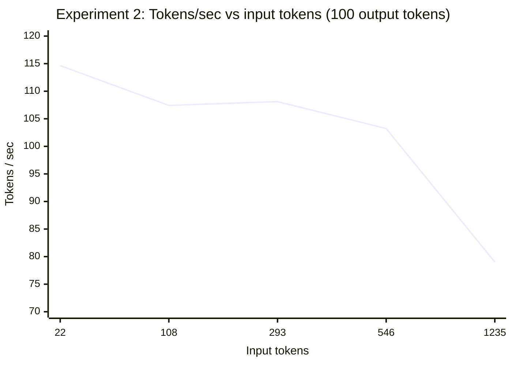
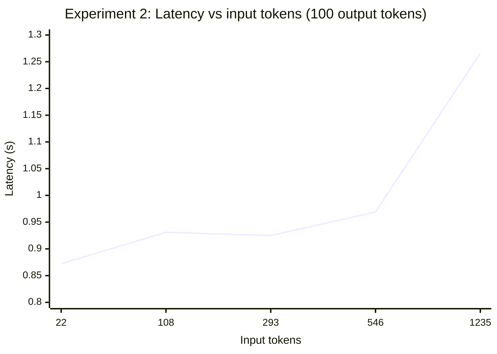

---
categories:
  - Engineering
topics:
  - ai
sources:
updated: 2026-10-21
---

In this post I build miniserve, a tiny LLM inference server. It's a FastAPI app wrapping [Qwen3-0.6B](https://huggingface.co/Qwen/Qwen3-0.6B), a small 0.6-billion-parameter model from Hugging Face. Then I run two experiments to see how input length and output length affect latency.

All the code is on GitHub: [pradyumnac26/miniserve](https://github.com/pradyumnac26/miniserve).

The goal isn't a fast server. The goal is a simple baseline I understand, so that later optimizations (a custom generation loop, the KV cache, batching) have something to be measured against.

---

## My Setup

Everything runs on one machine:

- **Machine:** MacBook Pro with an **Apple M4 Pro** chip
- **Accelerator:** the Apple GPU through PyTorch's **MPS** (Metal Performance Shaders) backend
- **Software:** Python 3.14, `torch` 2.14, `transformers` 5.20, `fastapi`, `uvicorn`

The server and the client (`curl` and my benchmark scripts) both run locally and talk over `127.0.0.1`. You don't need a separate GPU box. The same code works on a CUDA machine too, because `device_map="auto"` picks whichever device is available.

---

## Coding a tiny server

Set up the project:

```bash
mkdir miniserve
cd miniserve

python -m venv .venv
source .venv/bin/activate

pip install torch transformers fastapi uvicorn requests
```

Or clone the repo and install from [`requirements.txt`](https://github.com/pradyumnac26/miniserve/blob/main/requirements.txt):

```bash
git clone https://github.com/pradyumnac26/miniserve.git
cd miniserve
pip install -r requirements.txt
```

If you come back in a new terminal session, reactivate the venv first:

```bash
source .venv/bin/activate
```

Now create [`server.py`](https://github.com/pradyumnac26/miniserve/blob/main/server.py). Here it is, with comments explaining what each part does:

```python
import time
import torch

from fastapi import FastAPI
from pydantic import BaseModel, Field
from transformers import AutoTokenizer, AutoModelForCausalLM

# A small (0.6B parameter) model, so it runs comfortably on a laptop
MODEL_NAME = "Qwen/Qwen3-0.6B"

# The tokenizer converts text <-> token IDs for this specific model
tokenizer = AutoTokenizer.from_pretrained(MODEL_NAME)

# Downloads the weights from Hugging Face the first time (then uses the local cache).
# Every time the server starts, the weights are loaded from disk into memory.
model = AutoModelForCausalLM.from_pretrained(
    MODEL_NAME,
    device_map="auto",  # put the model on the best device: "mps" on my Mac, "cuda" on NVIDIA
    dtype="auto"        # use the precision the checkpoint was saved in
)

# "Evaluation mode" instead of "training mode": layers like dropout behave differently
model.eval()

# `uvicorn server:app` imports this module and looks for the object named `app`
app = FastAPI()


# The request body. Pydantic validates it for us:
# We cap max_output_tokens at 256 so one request can't take too long, since every output token is another forward pass (out-of-range values get a 422).
class GenerateRequest(BaseModel):
    prompt: str
    max_output_tokens: int = Field(
        default=50,
        ge=1,
        le=256
    )


@app.post("/generate")
def generate(request: GenerateRequest):

    # perf_counter(): it's a monotonic, high-resolution clock
    # meant for measuring durations. time.time() is wall-clock time, which can jump
    # if the system clock is adjusted .
    start_time = time.perf_counter()

    # 1. Wrap the prompt as a chat message.
    # Qwen3 is a chat/instruct model, so it expects its chat template, not raw text.
    messages = [
        {"role": "user", "content": request.prompt}
    ]

    # 2. Tokenize using the chat template.
    #    add_generation_prompt=True  -> appends the "assistant, your turn" marker
    #    enable_thinking=False       -> Qwen3 skips its <think>...</think> reasoning block,
    #                                   so every output token is part of the actual answer
    #    return_tensors="pt"         -> PyTorch tensors
    #    .to(model.device)           -> move the tokens to the same device as the model
    inputs = tokenizer.apply_chat_template(
        messages,
        tokenize=True,
        add_generation_prompt=True,
        enable_thinking=False,
        return_tensors="pt",
        return_dict=True
    ).to(model.device)

    # input_ids has shape [batch, sequence_length]; shape[1] is the prompt length.
    # Note: this includes the chat template tokens, not just my prompt text!
    input_token_count = inputs["input_ids"].shape[1]

    # 3. Run inference.
    # inference_mode() turns off gradient tracking, which is only needed for training.
    # model.generate() hides the two phases of inference:
    #   - Prefill: process the whole prompt at once and build the KV cache
    #   - Decode:  generate one output token at a time, reusing the KV cache
    with torch.inference_mode():
        outputs = model.generate(
            **inputs,
            max_new_tokens=request.max_output_tokens,
            do_sample=False,  # greedy decoding: always pick the most likely token
            use_cache=True    # use the KV cache (the default, but explicit here)
        )

    # 4. GPU work is asynchronous. Wait for the GPU to actually finish here,
    # so that when we stop the timer in step 7 it includes all the GPU work.
    if model.device.type == "cuda":
        torch.cuda.synchronize()
    elif model.device.type == "mps":
        torch.mps.synchronize()

    # 5. The output is [prompt tokens + generated tokens], so slice off the prompt.
    #                          batch 0   tokens after the prompt
    generated_tokens = outputs[0, input_token_count:]

    # 6. Convert token IDs back to text.
    # "decode" here means detokenize. It is NOT the decode phase of inference!
    response = tokenizer.decode(
        generated_tokens,
        skip_special_tokens=True
    )

    # 7. Metrics. This is end-to-end request time
    # (tokenize + prefill + decode + detokenize), not just model time.
    end_time = time.perf_counter()
    generation_time = end_time - start_time

    output_token_count = len(generated_tokens)

    return {
        "text": response,
        "input_tokens": input_token_count,
        "output_tokens": output_token_count,
        "latency_s": generation_time,
        "tokens_per_second": output_token_count / generation_time
    }
```

### What I changed from the "obvious" version

A few things here aren't in the most minimal version of this server, and each one came from something I ran into:

- **Chat template instead of raw tokenization.** Qwen3 is an instruct model, so I format the prompt with `apply_chat_template`. That means `input_tokens` is always a bit larger than my prompt text, because the template adds role markers. For example, `"What is AI?"` comes out as 16 input tokens.
- **`enable_thinking=False`.** By default Qwen3 can emit a `<think>` reasoning section first. I turned that off so the output token count measures the answer itself.
- **`torch.mps.synchronize()` / `torch.cuda.synchronize()`.** The GPU runs asynchronously from Python, so I wait for it to finish right after generation. That way, when the clock is stopped at the end of the request (`end_time = time.perf_counter()`), the measured time includes all the GPU work.
- **Input validation.** `max_output_tokens` is capped at 256. Asking for 300 gets back a clean `422 Unprocessable Content` error instead of a long-running request.

---

## Run the server

From the `miniserve` folder, with the venv active:

```bash
uvicorn server:app --port 8000
```

Uvicorn binds to `127.0.0.1` by default, which is all I need since the client is on the same machine. If you want to call it from another computer, use `--host 0.0.0.0`.

## Run the client

In a second terminal:

```bash
curl -X POST http://127.0.0.1:8000/generate \
  -H "Content-Type: application/json" \
  -d '{
    "prompt": "What is AI?",
    "max_output_tokens": 100
  }'
```

Response:

```json
{
  "text": "AI stands for **Artificial Intelligence**, which refers to the simulation of human intelligence tasks that are carried out by machines. ...",
  "input_tokens": 16,
  "output_tokens": 100,
  "latency_s": 0.845,
  "tokens_per_second": 118.34
}
```

It works! 🎉

### Two surprises from my first few requests

**1. The first request is slow.** My very first successful request (50 tokens) took **1.80 s**, or **27.7 tokens/sec**. The next one generated *twice* as many tokens in **0.85 s** (118 tokens/sec). The first call to the GPU pays one-time costs, like compiling Metal kernels and allocating memory. That's why my benchmark script does **warm-up runs** before measuring anything.

---

## Introducing Prefill and Decode

When an LLM generates a response, inference happens in two phases. In this server both are hidden inside `model.generate()`.

### Prefill

The model processes the entire input prompt in one forward pass and produces a key/value tensor for every prompt token, which is the KV cache. Prompt tokens can all be processed in parallel.

### Decode

The model then generates output tokens one at a time. This is called autoregressive decoding: token 2 can't be computed until token 1 has been picked. Each new token needs another forward pass, so more output tokens means more decode steps.

In simple words:

> total latency ≈ (prefill + one-time overhead) + (decode time per token) × output tokens

---

## Experiment 1: What happens as OUTPUT gets longer?

**Setup:** [`benchmark_output.py`](https://github.com/pradyumnac26/miniserve/blob/main/benchmark_output.py)

- Fixed prompt: `"Explain transformer architecture in detail."` (19 input tokens after the chat template)
- `max_output_tokens` = 10, 50, 100, 200, 250
- 3 warm-up requests first, then 5 runs per setting, averaged

```python
PROMPT = "Explain transformer architecture in detail."
OUTPUT_LENGTHS = [10, 50, 100, 200, 250]

NUM_RUNS = 5
WARMUP_RUNS = 3
```

### Results

| Max output | Actual output | Avg latency (s) | Avg tokens/sec |
| ---------- | ------------- | --------------- | -------------- |
| 10         | 10            | 0.099           | 100.84         |
| 50         | 50            | 0.417           | 119.85         |
| 100        | 100           | 0.810           | 123.49         |
| 200        | 200           | 1.605           | 124.58         |
| 250        | 250           | 2.026           | 123.39         |

Every request produced exactly the requested number of tokens, so the comparison is fair. The runs were also very consistent; for example, the five 100-token runs ranged from 0.803 s to 0.823 s.





### Observations


**Tokens/sec** rises from ~101 to ~124, then plateaus.

**Latency** is almost perfectly linear in the number of output tokens.

### Questions

**How long does it take to generate one token?**

Tokens/sec levels off at about 124, so each extra token costs about

$$
\frac{1}{124} \approx 0.008 \text{ s} = 8 \text{ ms}
$$

**Why is latency linear?**

Because of autoregressive decoding. Token 1 has to be generated before token 2, and so on, and every step costs about the same ~8 ms. So $N$ tokens cost about $N \times 8$ ms.

**Why does tokens/sec rise and then plateau?**

When the output is shorter, the start up time is relatively large compared to the token generation time. As the token generation time goes up, the start up time becomes relatively negligible.

---

## Experiment 2: What happens as INPUT gets longer?

**Setup:** [`benchmark_input.py`](https://github.com/pradyumnac26/miniserve/blob/main/benchmark_input.py)

- Five prompts of increasing length, all about Transformers and inference
- Always generate 100 output tokens
- One request per prompt

I used real, increasingly long passages of text. The tokenizer measures the actual length, including the chat template.

### Results

| Input tokens | Output tokens | Latency (s) | Tokens/sec | Extra latency vs shortest prompt |
| ------------ | ------------- | ----------- | ---------- | -------------------------------- |
| 22           | 100           | 0.872       | 114.64     | —                                |
| 108          | 100           | 0.931       | 107.42     | +59 ms                           |
| 293          | 100           | 0.925       | 108.11     | +53 ms                           |
| 546          | 100           | 0.969       | 103.23     | +97 ms                           |
| 1235         | 100           | 1.266       | 79.02      | +394 ms                          |





### Observations

**Tokens/sec goes down** as the prompt gets longer: from ~115 to ~79. That's the opposite of Experiment 1. The output count is the same in every row, so any extra time from a longer input drags tokens/sec down.

**Latency goes up** with longer inputs, but not evenly, so it is roughly linear.

### Questions

**Why does the throughput go down?**

Tokens/sec here is output tokens divided by total latency:

$$
\text{tokens/sec} = \frac{100}{T(P, 100)}
$$

The top of the fraction is always 100 in our case as we are generating 100 tokens only, so anything that makes the request take longer pushes tokens/sec down. So more latency reduces the throughput. A longer prompt adds time in two places:

- **Prefill gets bigger.** The model has to process every prompt token before it can produce the first output token. 1235 tokens is a lot more work than 22, even when it's done in parallel.
- **Each decode step gets a bit slower.** Every new token attends over the whole KV cache, and the cache now holds 1235 prompt tokens instead of 22. More keys and values have to be read on every step.

From these numbers alone I can't tell how much of the drop comes from prefill and how much from slower decoding, because `latency_s` measures the whole request as one number.

To separate the two, I need to replace `model.generate()` with my own loop and time prefill and decode independently.

---

## Takeaways

1. Inference has two phases: prefill and decode.
2. Output length drives decode work. Latency grew almost perfectly linearly with output tokens, at **~8 ms per token** on my machine, and tokens/sec plateaued around 124.
3. Input length affects both phases. Longer prompts increased latency and reduced tokens/sec, but an end-to-end measurement can't separate prefill from decode.
4. Benchmarking hygiene matters Warm-up runs (the first request was 4× slower), checking actual output token counts (the model can stop early), GPU synchronization, and repeated runs all changed what the numbers meant.

When you later look at vLLM or SGLang optimizations, you'll see many of them target one phase more than the other. Prefix caching avoids repeating prefill for shared prompt prefixes. Continuous batching keeps the GPU busy during decode by mixing many requests together.

---

## Next steps

- Write my own generation loop instead of using `model.generate()`
- Understand and use the KV cache directly
- Measure prefill (time to first token) and decode (time per output token) separately
- Re-run Experiment 2 with warm-up and repeated runs, and push to longer prompts

The server, both benchmark scripts, and [`plot_results.py`](https://github.com/pradyumnac26/miniserve/blob/main/plot_results.py) (which regenerates the graphs) are all in the [miniserve repo](https://github.com/pradyumnac26/miniserve).
