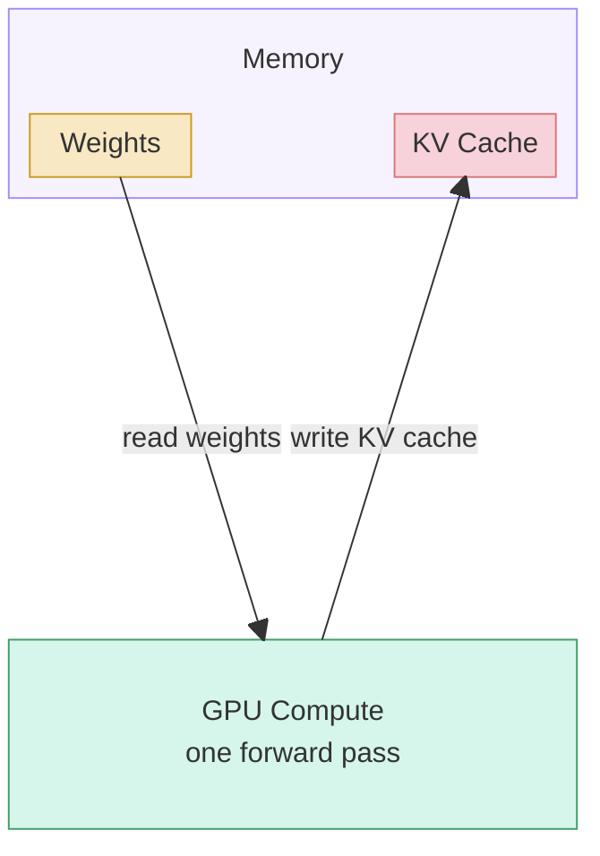
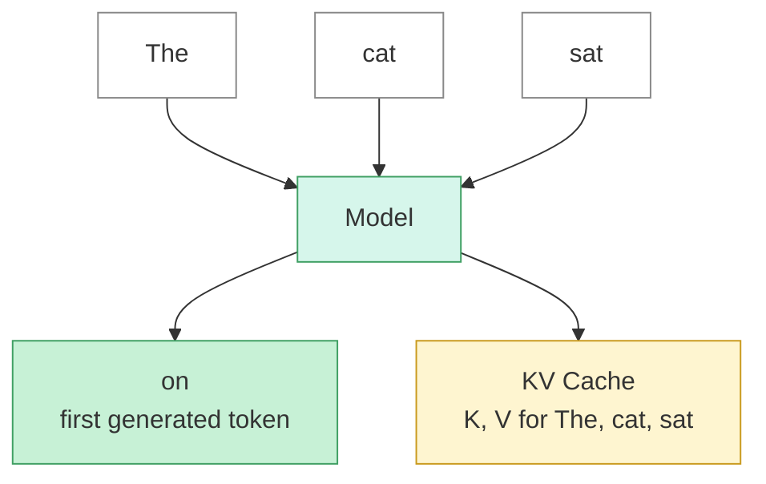

---
categories:
  - Engineering
topics:
  - ai
sources:
updated: 2026-10-23
---

Prefill is the first phase of LLM Inference. Once it finishes, the [[Decode]] phase takes over and generates the rest of the answer one token at a time.

During prefill, given a prompt, all prompt tokens are processed at the same time, in parallel, in one pass through the model. Each transformer layer computes keys and values projections for every prompt token and stores them in KV Cache. 
The model then produces the probability distribution for the first output token.

### What the hardware does

The GPU reads the model weights from memory, runs one forward pass over the whole prompt, and writes the keys and values for every prompt token back to memory as the KV cache.

### What happens to the tokens

All prompt tokens go into the model together. Out comes the first generated token, plus the KV cache that the [[Decode|decode phase]] will reuse.

Prefill is usually compute-bound, because the whole sequence is processed in parallel, so prefill is limited by GPU FLOPs. 

### What makes Prefill phase slow ? 

- Longer Prompt
- Bigger model: more parameters means more FLOPs per token
- Less GPU compute: fewer FLOPs per second means the same work takes longer

### Time to first token (TTFT)

TTFT is the lag between submitting a prompt and seeing the first output token. It is essentially the time prefill takes.

In [[Building a Tiny Inference Server]], I saw this in practice: longer prompts made each request slower, partly because prefill had more tokens to process.

