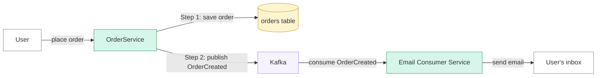
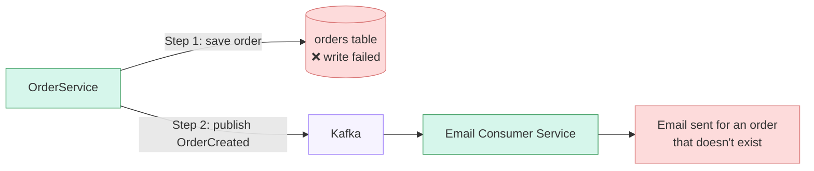
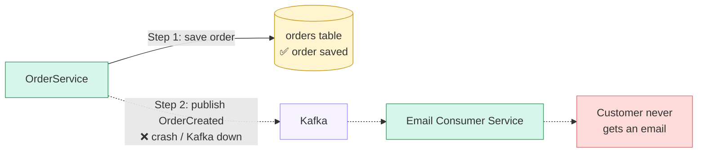
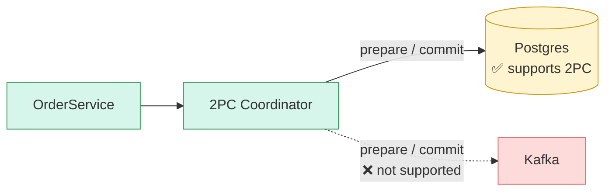
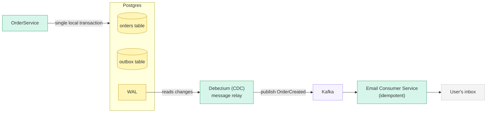

---
categories:
  - Engineering
topics:
  - distributed systems
sources:
updated: 2026-11-09
---

The Transactional Outbox Pattern is a system design pattern we use when we want to change business data in our database and also reliably publish that change to another system, such as [[Kafka Fundamentals|Kafka]].

Let’s consider an example. Say we have an e-commerce system. When an order is created, the OrderService stores the order details in our `orders` table. We also want to notify the user that the order has been created, and for that we use an email service. So we publish an event called `OrderCreated` to Kafka, and our email consumer service consumes that event from Kafka and sends the email. 

 
So there can be 2 failure cases in such scenarios 

1. _Failure case 1:_ the database write fails, but the event is published**

2. _Failure case 2:_ the order is saved, but the event is never published**

So this is basically called as the **dual write** problem, when you have to write across 2 different systems, but failure can happen during the action in any system. 

One solution that comes to mind is to wrap both operations in a single transaction. That is, saving the order and publishing the `OrderCreated` event should happen atomically. This is essentially a two-phase commit (2PC). But Kafka doesn’t support distributed transactions with external systems like how our Postgres database supports, so that’s where the Transactional Outbox Pattern comes in.

So instead, we can create another table, called the **outbox table**. When we save an order to the `orders` table, we also insert a row into the outbox table recording that the order was created, and we do both **in the same database transaction**, so either both rows are saved or neither is. 

Next, we need a component that moves events from the outbox table to Kafka. This is called the message relay.  One option is a polling service that repeatedly queries the outbox table for new events and publishes them to Kafka. But there’s a drawback: the service keeps querying the table even when nothing has changed, which adds overhead and some latency. 

A more efficient option is change data capture (CDC), and a popular tool for it is Debezium. Instead of querying the table, CDC reads the database’s write-ahead log (WAL), where the database records every change before applying it. When a new row appears in the outbox table, the CDC tool detects it in the WAL and publishes the corresponding event to Kafka. In this setup, CDC acts as the message relay.

This way, we can reliably deliver events between the two systems. Delivery is at-least-once, so the email service should be idempotent to handle duplicate events. 

The [[Claim Check Pattern]] runs into the same dual write problem (write to storage, then send a message), and the outbox is one way to solve it there too.

